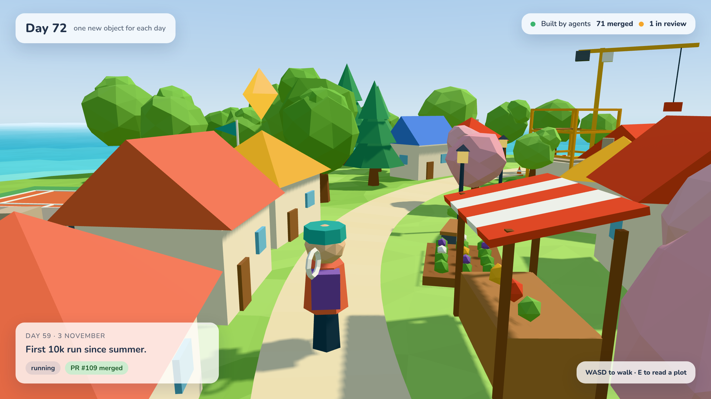
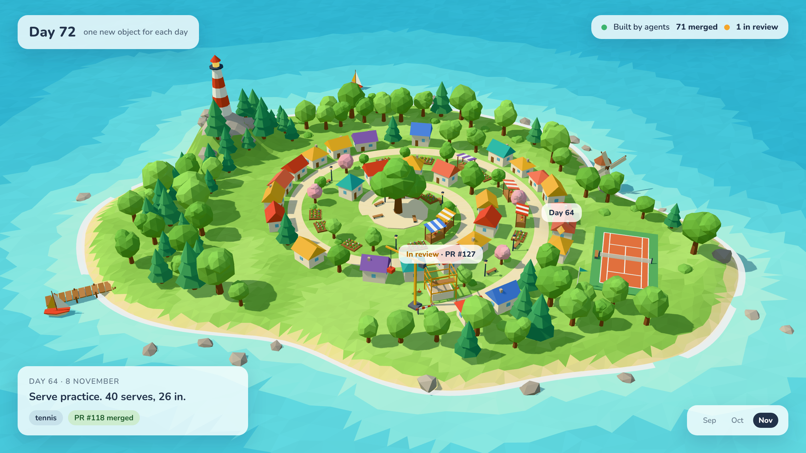

# Life Island: target

This page is the goal that all work moves toward. Each work item (human or agent) must move the game nearer to this page. If a change disagrees with this page, change the page first, in its own PR.

## The idea

Life Island is a small low-poly island in the browser. It grows by one object for each day of my life. I write one short log line each day. An agent turns the line into a journal entry and one new object on the island, and opens a PR. I review and merge it.

A visitor walks the island behind a small character and reads my days at the houses, gardens, and courts that they made.

## The world

- **Day 1 is the large tree in the center.** A street goes out from the center in a spiral. Each day gets the next plot on the street, on alternating sides.
- **The layout is a formula.** The same entries always give the same island. Positions come from the day number, not from random numbers. Random details (tree shape, roof color) come from a seed that is the day number.
- **Landmarks are themes of my life.** One landmark for each theme, outside the spiral: the tennis court, the lighthouse on the hill, the windmill, the pier. A theme day adds a small object near its landmark and also gets its plot on the street.
- **Open PRs are construction sites.** The newest plot shows scaffolding, a crane, and cones while its PR is in review. After the merge, the finished object replaces it.
- **One island for each year.** At the end of a year, the island is complete. A new island starts, and a boat goes between them. (Not in version 1.)

## Camera and controls

| Mode | Use | Controls |
| :- | :- | :- |
| Street (main) | Walk and read the days. | Camera behind the character, a little above. Keyboard: WASD or arrows, E to read. Phone: tap a point to walk to it, tap a plot to read it. |
| Map (zoom-out) | See the full story, jump to a day. | Scroll or pinch out from street mode. Tap a plot to walk there. |
| First person (later) | Optional. | A toggle in settings. |

## The first 30 seconds of a visit

1. The page opens on the map view of the full island. The day counter shows "Day N". The construction site, if a PR is open, has a label.
2. The camera moves down to the character, which stands at the newest finished plot. Street mode starts. A short hint shows the controls.
3. The panel at the bottom left shows the entry of that day.
4. The visitor walks. Near a plot, its day number shows. Press E or tap, and the entry opens.
5. A small panel at the top right shows the agent status ("71 merged, 1 in review"). It links to the factory page.

The first image must load in less than 3 seconds on a mid-range phone.

## Look rules

- **Style:** low poly, flat shading, soft shadows, no textures. All shapes are made in code from simple solids (boxes, cones, low-detail spheres). Free CC0 models only when code cannot make a shape.
- **Light:** daylight, sun from the left, a sky gradient, and fog to the horizon in street mode. Night comes later: at night each plot turns on its light.
- **Palette:** grass greens, sand, sea turquoise, white walls, and these roof colors: coral, mustard, teal, purple, blue, red. A new object uses colors from this palette only.
- **Scale:** the character is about half the wall height of a house. A plot is 1 by 1 unit. The street is 0.8 units wide.
- **Interface:** rounded light panels with a soft shadow, the Nunito font. Few panels: day counter, agent status, entry, hint.
- **Speed budgets:**
  - One object type: at most 600 triangles.
  - Street mode: at most 300 draw calls. Map mode: at most 400 draw calls (combine meshes).
  - First download: at most 1.5 MB.

## Object types for version 1

| Type | When the agent selects it | Shown as |
| :- | :- | :- |
| House | Default for an ordinary day. | House with a roof color from the palette. |
| Tree | A quiet or rest day. | Round tree or pine tree. |
| Garden | Something grew: a habit, a skill, a project. | Garden plot with flowers. |
| Market stall | Social day, friends, family, an event. | Stall with a striped roof. |
| Bench and lamp | A day to think, read, or learn. | Bench next to a street lamp. |
| Tennis | Tennis practice or a match. | Plot object plus a small item at the court (ball basket, flag). |
| Work | A work milestone. | Workshop with a chimney. |
| AI study | Something new in AI that I learned. | Small observatory. |

If no type fits, the agent opens an issue for a new type. It does not make one in the daily PR.

## How a day becomes an object

1. I write a log line, for example as a GitHub issue from my phone.
2. The agent opens one PR with two files: the journal entry (text, date, tags) and one line in the world data (day, object type, seed).
3. CI renders the new plot from fixed camera positions. The PR shows the images.
4. I merge. The site publishes.

The raw log stays private. Only text that I approve goes into the public repository.

## Version 1 is done when

Each step must look finished, not like a rough draft. A step is small, but it must look like the images on this page.

1. **One street.** Day 1 tree, 10 plots with house, tree, and garden. The character walks with keyboard and phone controls. Street camera only.
2. **Reading.** Plot labels, the entry panel, and the journal data from files.
3. **Map view.** Zoom-out, jump to a day, the visit start from the first 30 seconds.
4. **Daily loop.** The agent PR from a log line, CI images in the PR, construction sites for open PRs.
5. **Landmarks.** Tennis court and the other landmarks, plus all object types in the table.
6. **Factory page.** Agent statistics: merged PRs, review time, rejection rate, cost for each PR.

## Rules for tests

- The layout formula has exact tests: no overlap, all plots reachable from the center, the same input gives the same output.
- Each object type has a fixed camera image. CI compares the images, and a changed image needs my approval.
- CI checks the speed budgets (triangles, draw calls, download size).

## Open questions

- Which landmarks: tennis, work, AI study, and which others?
- What is day 1: the start date of the project, or a date that has meaning to me?
- Name of the site and the domain.
